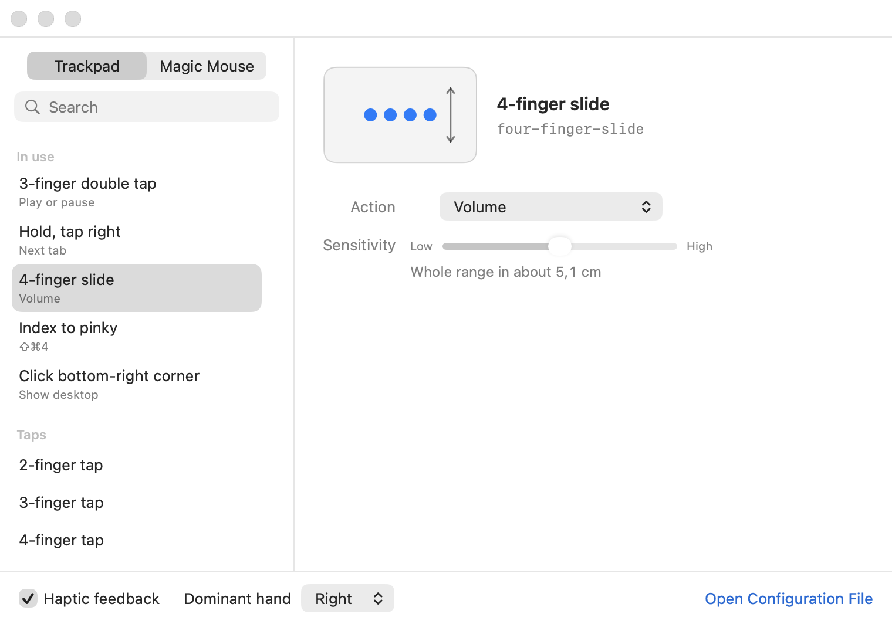

# OpenGestures

[](https://github.com/rafaelcaetite/OpenGestures/actions/workflows/ci.yml)
[](https://github.com/rafaelcaetite/OpenGestures/releases/latest)


[](LICENSE)

Custom trackpad and Magic Mouse gestures for macOS, including continuous
gestures that keep acting while your fingers move: slide four fingers to set
the volume as you would drag a slider, or three fingers sideways to pick an
app in the Command-Tab switcher.

[Português](README.pt-BR.md)



## Contents

- [Features](#features)
- [Compatibility](#compatibility)
- [Installation](#installation)
- [Getting started](#getting-started)
- [Configuration](#configuration)
- [Command line](#command-line)
- [Performance](#performance)
- [Documentation](#documentation)
- [Development](#development)
- [Uninstalling](#uninstalling)

## Features

- **Continuous gestures.** A slide acts for every millimetre or so of
  movement, in either direction, for as long as the fingers stay down.
  Volume and brightness follow the fingers with no lag; zoom, tabs, undo,
  desktops, tracks and the app switcher are built in, and any two actions
  can be paired.
- **75 gestures**: taps and double taps, hold and tap, swipes, slides,
  finger rolls, and clicks with several fingers, along an edge or in a
  corner. See [docs/gestures.md](docs/gestures.md).
- **Actions**: key combinations resolved against your keyboard layout,
  system actions, media keys, URLs with placeholders, applications, menu
  commands, scripts, typed text and timed sequences.
- **A small editor** for the common cases, and a plain text file for
  everything else: per-application bindings, bindings that apply only while
  Fn is held, and sequences.
- **Scrolling.** Separate scroll direction for the trackpad and the mouse,
  and no stray scrolling while three or four fingers drive a gesture.
- **English and Portuguese**, following the system language.
- **Light**: about 8 MB of memory and no CPU while idle. See
  [Performance](#performance).

## Compatibility

Every Mac that runs **macOS 13 Ventura or later**, Apple silicon or Intel:
MacBook Pro 2017+, MacBook Air 2018+, MacBook 2017, iMac 2017+, iMac Pro,
Mac mini 2018+, Mac Studio and Mac Pro 2019+.

| Device | Supported |
| --- | --- |
| Built-in trackpad | All trackpad gestures, with haptic feedback |
| Magic Trackpad 2 and Magic Trackpad (USB-C) | All trackpad gestures, with haptic feedback |
| Magic Trackpad (first generation) | All trackpad gestures, without haptic feedback |
| Magic Mouse (all generations) | Mouse gestures |
| Other mice | Scroll direction only |

Details, hardware-dependent features and what has been tested are in
[docs/compatibility.md](docs/compatibility.md).

## Installation

### Download

1. Download `OpenGestures-<version>.zip` from the
   [latest release](https://github.com/rafaelcaetite/OpenGestures/releases/latest)
   and unzip it.
2. Move `OpenGestures.app` to Applications.
3. Open it. The app is not notarized, so macOS refuses the first time: open
   System Settings > Privacy & Security, find the message about
   OpenGestures and choose **Open Anyway**.
4. Allow **Accessibility** when asked, or in System Settings > Privacy &
   Security > Accessibility.

The app adds itself to the login items the first time it runs from an
Applications folder.

### Build from source

Requires Xcode or the Command Line Tools (`xcode-select --install`).

```sh
git clone https://github.com/rafaelcaetite/OpenGestures.git
cd OpenGestures
make install
```

This builds for your Mac, installs to `~/Applications`, and starts the app.
Use `make install ARCHS="arm64 x86_64"` for a universal build and
`make install PREFIX=/Applications` to install for all users. `make link`
adds an `opengestures` command to `~/.local/bin`.

Local builds are signed so that the Accessibility permission survives
rebuilds.

## Getting started

Choose **Edit Gestures…** from the menu bar icon, or open the app again
while it runs. Pick a gesture on the left and an action on the right; slides
also have a sensitivity slider. Changes apply immediately.

OpenGestures observes the trackpad; it does not stop macOS from responding
to the same movement. When a gesture is also used by macOS, the editor says
so and links to System Settings > Trackpad, where you can turn the macOS
gesture off.

## Configuration

The editor writes to `~/.config/opengestures/config.toml`, a commented text
file that is reloaded as soon as it is saved. The editor changes only the
lines it needs, so hand-written comments stay. Mistakes are reported with
their line number and the last valid configuration stays active.

```toml
[GENERAL]
trackpad-natural-scrolling = true
mouse-natural-scrolling = false

[TRACKPAD]
four-finger-slide = "volume"                 # Up and down set the volume
three-finger-slide = "apps"                  # Pick an app in the ⌘⇥ switcher
three-finger-double-tap = "play-pause"
hold-left-tap-right = "next-tab"             # Rest a finger, tap to its right
bottom-right-corner-click = "show-desktop"
fn+four-finger-slide = "brightness"          # Only while Fn is held

[TRACKPAD."Safari, Google Chrome"]
four-finger-slide = "tabs"

[MOUSE]
two-finger-tap = "middle-click"
```

| Value | Effect |
| --- | --- |
| `"cmd+shift+4"` | Press a key combination (`cmd`, `shift`, `opt`, `ctrl`, `fn`) |
| `"mission-control"` | Run a [built-in action](docs/configuration.md#built-in-actions) |
| `"url:https://example.com/?q={{clipboard\|urlencode}}"` | Open a URL with placeholders |
| `"app:Safari"` | Open an application |
| `"menu:File > New Window"` | Choose a menu item in the frontmost app |
| `"script:~/bin/tool"` | Run an executable |
| `"text:Kind regards"` | Type text |
| `["cmd+c", "wait:100", "app:Notes"]` | Run several steps in order |
| `{ action = "cmd+w", haptic = false, sound = "Pop" }` | Add options |

Slides take a preset (`volume`, `brightness`, `keyboard-backlight`, `zoom`,
`tabs`, `history`, `undo`, `spaces`, `tracks`, `apps`) or a table with any of
`up`, `down`, `left` and `right`, plus an optional `step` in millimetres and
`hold` for modifier keys held during the slide.

The full reference is [docs/configuration.md](docs/configuration.md).

## Command line

```
OpenGestures check [file]   Validate a configuration and list overlaps with macOS gestures
OpenGestures trace [--all]  Print gestures as they are recognized, without running actions
OpenGestures gestures       List every gesture
OpenGestures actions        List built-in actions, presets and action prefixes
```

`trace` is the quickest way to see what OpenGestures recognizes. With
`--all` it reports every discrete gesture, bound or not.

## Performance

OpenGestures reads contact frames from `MultitouchSupport.framework` about a
hundred times a second while fingers are down, and processes each one on the
framework's own thread with no queuing and no allocation on ordinary frames.
Measured on a 2019 MacBook Pro (Intel Core i9):

| | |
| --- | --- |
| Frame with no fingers | 0.12 µs |
| Frame with fingers resting | 0.38 µs |
| Frame of a four-finger slide | 1.2 µs, about 0.01% of one core at 100 frames a second |
| Idle CPU | 0%, with no timers or polling |
| Memory | About 8 MB |
| App size | 1.8 MB, universal |

Event taps for clicks and scrolling exist only while a setting needs them.
The gesture editor is created when opened and released when closed.
[docs/architecture.md](docs/architecture.md) explains the design.

## Documentation

| Document | Contents |
| --- | --- |
| [Compatibility](docs/compatibility.md) | Macs, input devices, hardware-dependent features, testing |
| [Gestures](docs/gestures.md) | Every gesture and how it is recognized |
| [Configuration](docs/configuration.md) | Settings, bindings, actions, presets and examples |
| [Troubleshooting](docs/troubleshooting.md) | Permissions, overlaps, sensitivity, missed taps |
| [Architecture](docs/architecture.md) | Data flow, threading, performance, the editor |
| [Changelog](CHANGELOG.md) | Changes in each release |
| [Contributing](CONTRIBUTING.md) | Building, testing, reporting problems |

## Development

```sh
make test       # Run the test suite
make app        # Build .build/OpenGestures.app
make zip        # Build a distributable archive
```

The recognizer, configuration and action parsing are covered by unit tests
that feed synthetic touch frames, so no hardware is needed to run them.

## Uninstalling

From a source checkout, run `make uninstall`. Otherwise turn off **Open at
Login** in the OpenGestures menu, quit it, and delete the app. Your configuration in
`~/.config/opengestures` is kept. Also remove OpenGestures from System
Settings > Privacy & Security > Accessibility.

## Acknowledgements

The contact layout of MultitouchSupport was documented by the
reverse-engineering work behind projects such as
[Jitouch](https://github.com/JitouchApp/Jitouch), whose gesture vocabulary
inspired several of the gestures here.

## License

[MIT](LICENSE)
