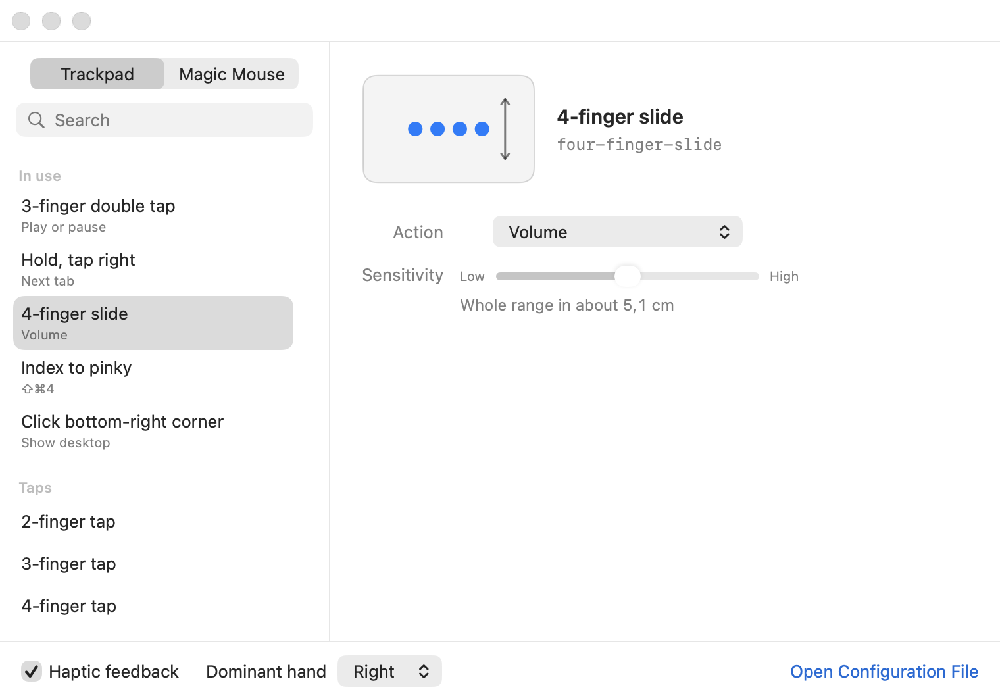

# OpenGestures

[](https://github.com/rafaelcaetite/OpenGestures/actions/workflows/ci.yml)
[](https://github.com/rafaelcaetite/OpenGestures/releases/latest)


[](LICENSE)

Gestos personalizados para o trackpad e o Magic Mouse no macOS, incluindo
gestos contínuos, que continuam agindo enquanto os dedos se movem: deslize
quatro dedos para ajustar o volume como quem arrasta uma barra, ou três
dedos para os lados para escolher um app no seletor do Command-Tab.

[English](README.md)



## Sumário

- [Recursos](#recursos)
- [Compatibilidade](#compatibilidade)
- [Instalação](#instalação)
- [Primeiros passos](#primeiros-passos)
- [Configuração](#configuração)
- [Linha de comando](#linha-de-comando)
- [Desempenho](#desempenho)
- [Documentação](#documentação)
- [Desinstalação](#desinstalação)

## Recursos

- **Gestos contínuos.** Um deslize age a cada milímetro, mais ou menos, nas
  duas direções, enquanto os dedos estiverem encostados. Volume e brilho
  acompanham os dedos sem atraso; zoom, abas, desfazer, mesas, faixas e o
  seletor de apps já vêm prontos, e qualquer par de ações pode ser usado.
- **75 gestos**: toques e toques duplos, segurar e tocar, passadas,
  deslizes, sequência de dedos e cliques com vários dedos, nas bordas ou
  nos cantos. Veja [docs/gestures.md](docs/gestures.md).
- **Ações**: atalhos de teclado que respeitam o layout do teclado, ações do
  sistema, teclas de mídia, URLs com variáveis, apps, comandos de menu,
  scripts, texto digitado e sequências.
- **Um editor pequeno** para o dia a dia, e um arquivo de texto para o
  resto: atalhos por app, atalhos só com Fn pressionado e sequências.
- **Rolagem.** Direção de rolagem separada para trackpad e mouse, e nenhuma
  rolagem indesejada enquanto três ou quatro dedos fazem um gesto.
- **Português e inglês**, conforme o idioma do sistema.
- **Leve**: cerca de 8 MB de memória e nenhum uso de CPU parado. Veja
  [Desempenho](#desempenho).

## Compatibilidade

Todo Mac que roda **macOS 13 Ventura ou mais novo**, com Apple silicon ou
Intel: MacBook Pro 2017+, MacBook Air 2018+, MacBook 2017, iMac 2017+, iMac
Pro, Mac mini 2018+, Mac Studio e Mac Pro 2019+.

| Dispositivo | Suporte |
| --- | --- |
| Trackpad embutido | Todos os gestos de trackpad, com resposta tátil |
| Magic Trackpad 2 e Magic Trackpad (USB-C) | Todos os gestos de trackpad, com resposta tátil |
| Magic Trackpad (primeira geração) | Todos os gestos de trackpad, sem resposta tátil |
| Magic Mouse (todas as gerações) | Gestos de mouse |
| Outros mouses | Só a direção da rolagem |

Detalhes, recursos que dependem do hardware e o que já foi testado estão em
[docs/compatibility.md](docs/compatibility.md) (em inglês).

## Instalação

### Download

1. Baixe `OpenGestures-<versão>.zip` da
   [versão mais recente](https://github.com/rafaelcaetite/OpenGestures/releases/latest)
   e descompacte.
2. Mova `OpenGestures.app` para Aplicativos.
3. Abra. O app não é notarizado, então o macOS recusa na primeira vez: abra
   Ajustes do Sistema > Privacidade e Segurança, encontre o aviso sobre o
   OpenGestures e escolha **Abrir Mesmo Assim**.
4. Permita a **Acessibilidade** quando pedir, ou em Ajustes do Sistema >
   Privacidade e Segurança > Acessibilidade.

Na primeira vez que roda de uma pasta de Aplicativos, o app se adiciona aos
itens de início de sessão.

### Compilar o código

Precisa do Xcode ou das Command Line Tools (`xcode-select --install`).

```sh
git clone https://github.com/rafaelcaetite/OpenGestures.git
cd OpenGestures
make install
```

Isso compila para o seu Mac, instala em `~/Applications` e abre o app. Use
`make install ARCHS="arm64 x86_64"` para um app universal e
`make install PREFIX=/Applications` para instalar para todos os usuários.
`make link` cria o comando `opengestures` em `~/.local/bin`.

Compilações locais são assinadas de forma que a permissão de Acessibilidade
continua valendo depois de recompilar.

## Primeiros passos

Escolha **Editar gestos…** no ícone da barra de menus, ou abra o app de novo
com ele rodando. Escolha um gesto à esquerda e a ação à direita; os
deslizes também têm um controle de sensibilidade. As mudanças valem na hora.

O OpenGestures observa o trackpad; ele não impede o macOS de reagir ao
mesmo movimento. Quando um gesto também é usado pelo macOS, o editor avisa
e leva até Ajustes do Sistema > Trackpad, onde dá para desligar o gesto do
sistema.

## Configuração

O editor grava em `~/.config/opengestures/config.toml`, um arquivo de texto
comentado que é recarregado assim que é salvo. O editor muda só as linhas
necessárias, então comentários escritos à mão continuam lá. Erros são
indicados com o número da linha, e a última configuração válida continua
ativa.

```toml
[GENERAL]
trackpad-natural-scrolling = true
mouse-natural-scrolling = false

[TRACKPAD]
four-finger-slide = "volume"                 # Para cima e para baixo ajustam o volume
three-finger-slide = "apps"                  # Escolhe um app no seletor ⌘⇥
three-finger-double-tap = "play-pause"
hold-left-tap-right = "next-tab"             # Apoie um dedo e toque à direita
bottom-right-corner-click = "show-desktop"
fn+four-finger-slide = "brightness"          # Só com Fn pressionado

[TRACKPAD."Safari, Google Chrome"]
four-finger-slide = "tabs"

[MOUSE]
two-finger-tap = "middle-click"
```

A referência completa, em inglês, está em
[docs/configuration.md](docs/configuration.md).

## Linha de comando

```
OpenGestures check [arquivo]  Valida a configuração e lista conflitos com gestos do macOS
OpenGestures trace [--all]    Mostra os gestos reconhecidos, sem executar ações
OpenGestures gestures         Lista todos os gestos
OpenGestures actions          Lista ações, predefinições e prefixos
```

## Desempenho

Medido num MacBook Pro 2019 (Intel Core i9):

| | |
| --- | --- |
| Frame sem dedos | 0,12 µs |
| Frame com dedos parados | 0,38 µs |
| Frame de um deslize com quatro dedos | 1,2 µs, cerca de 0,01% de um núcleo a 100 frames por segundo |
| CPU parado | 0%, sem timers nem verificações periódicas |
| Memória | Cerca de 8 MB |
| Tamanho do app | 1,8 MB, universal |

## Documentação

| Documento | Conteúdo |
| --- | --- |
| [Compatibilidade](docs/compatibility.md) | Macs, dispositivos, recursos que dependem do hardware, testes |
| [Gestos](docs/gestures.md) | Todos os gestos e como são reconhecidos |
| [Configuração](docs/configuration.md) | Ajustes, atalhos, ações, predefinições e exemplos |
| [Solução de problemas](docs/troubleshooting.md) | Permissões, conflitos, sensibilidade, toques perdidos |
| [Arquitetura](docs/architecture.md) | Fluxo de dados, threads, desempenho, o editor |
| [Changelog](CHANGELOG.md) | Mudanças de cada versão |
| [Como contribuir](CONTRIBUTING.md) | Compilar, testar, relatar problemas |

Os documentos em `docs/` estão em inglês.

## Desinstalação

A partir do código, rode `make uninstall`. Senão, desmarque **Abrir ao
iniciar sessão** no menu do OpenGestures, encerre o app e apague-o. A configuração em `~/.config/opengestures` é
mantida. Remova também o OpenGestures de Ajustes do Sistema > Privacidade e
Segurança > Acessibilidade.

## Licença

[MIT](LICENSE)
